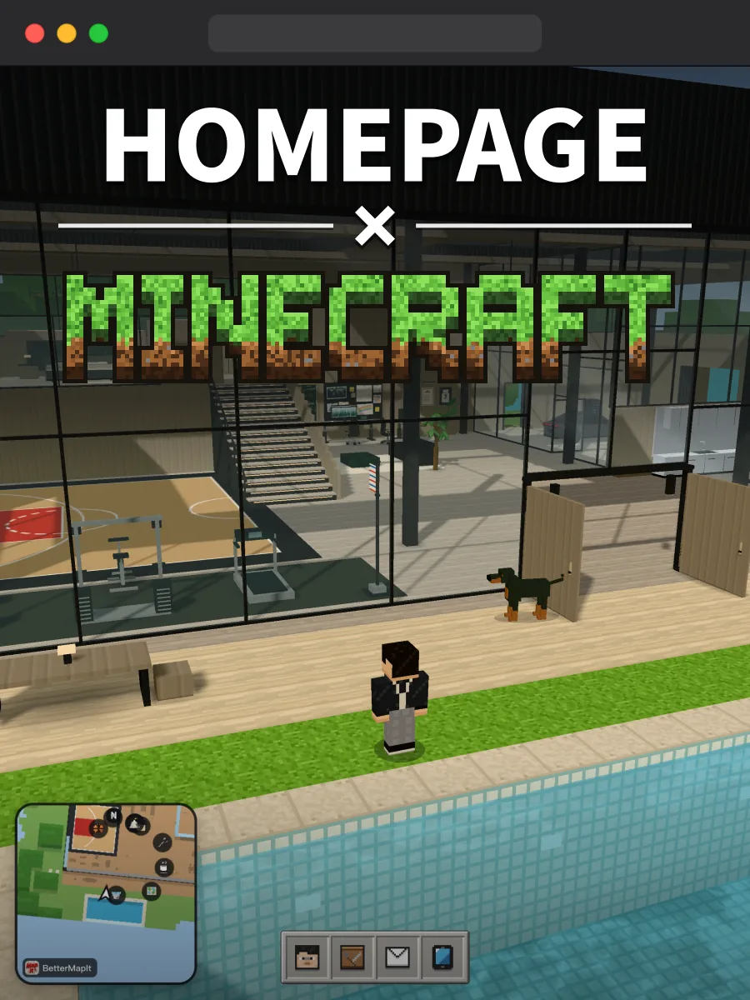
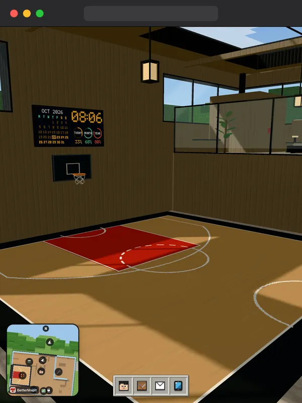
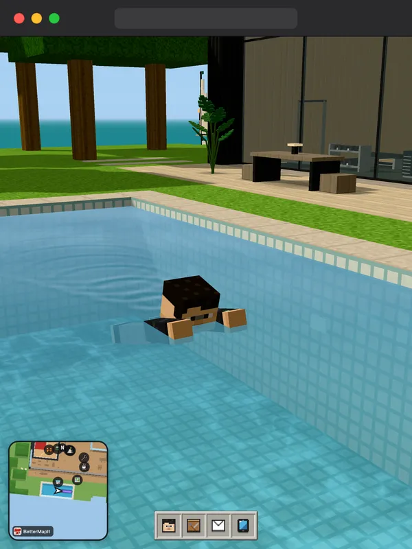
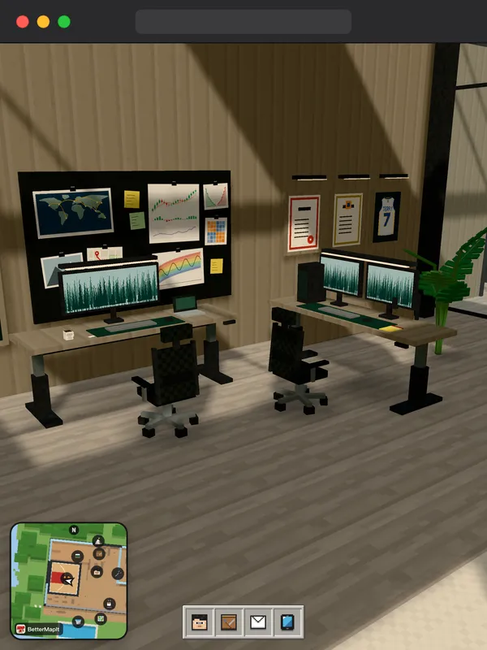
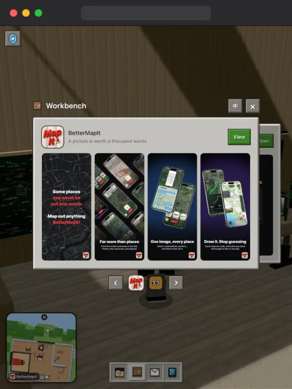
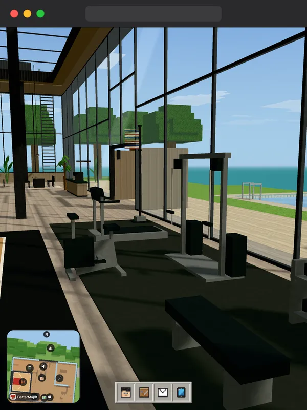
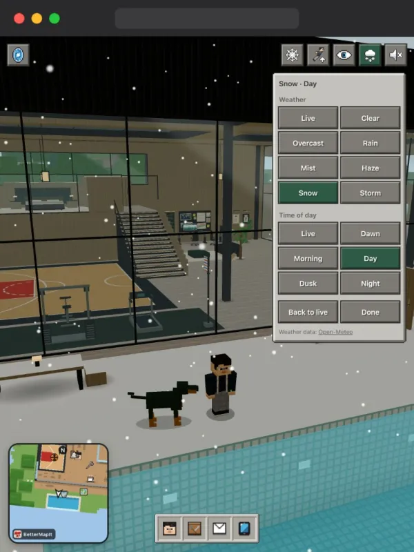
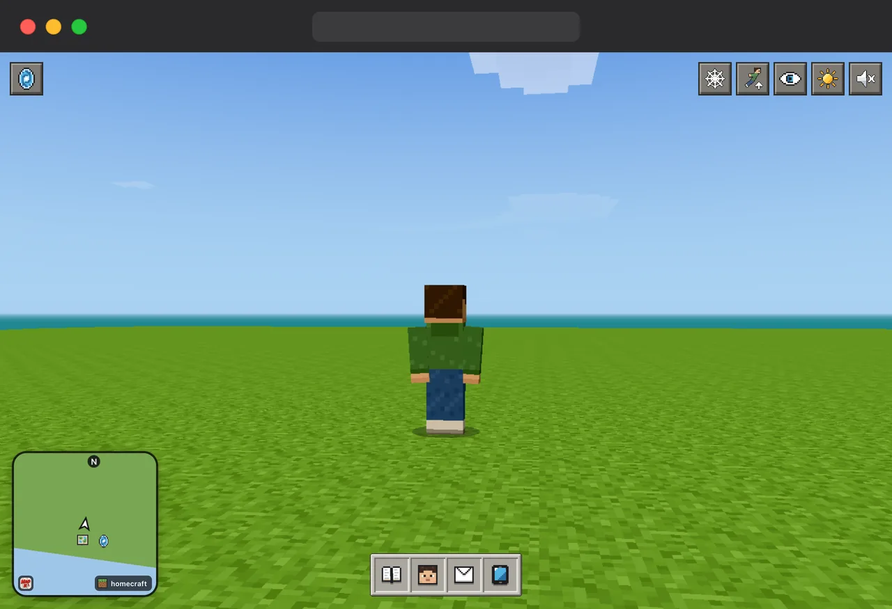
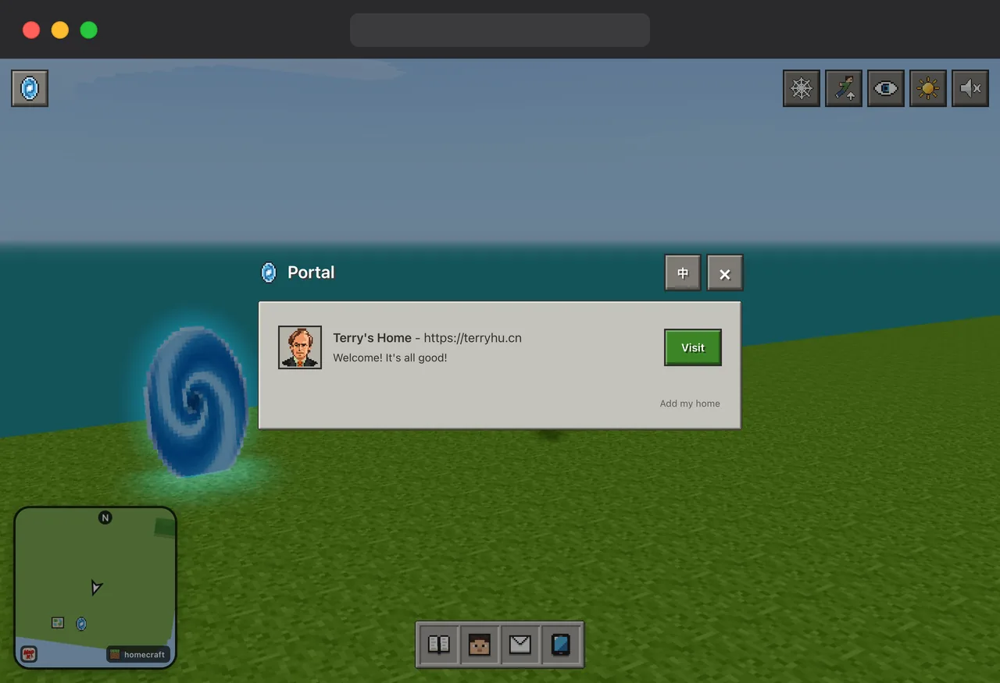

# Homecraft

[中文](README.md) · **English**

## Homepage + Minecraft = Homecraft

I've always liked tinkering with my website, but every template I tried felt like a box.

So, inspired by Minecraft, The Matrix and the metaverse, I used AI to turn it from a flat page into a 3D world.

You can roam anywhere. There's a basketball court, a gym, a workbench, even a day–night cycle and weather.

Regular web pages live inside it too: press F to open one. Blocks are cheap to render, so it runs fine on phones.

A walk around feels like dropping by a friend's place. It's a more memorable way to get to know someone than a regular website.

Once you get used to it, there's no going back to a regular personal website…

## Screenshots [🔗 Terry’s Home](https://terryhu.cn)

| Basketball court | Pool | Workbench |
| :-: | :-: | :-: |
|  |  |  |
| **Works** | **Gym** | **Weather** |
|  |  |  |

## Getting started

The project includes a starter template, AI prompts and constraints. Fork it and start vibe coding your own world.

Run a single command, `python3 tools/serve.py`, in the project folder. It picks a random port and automatically opens your browser.

The full source of Terry's Home is in [examples/terry-home](examples/terry-home).

## Portal [🔗 Request listing](https://github.com/terryHu7/homecraft/issues/new/choose)

Like a blogroll, the portal lists everyone's personal websites, so people can drop by each other's place.

## Links [🔗 LINUX DO](https://linux.do)
