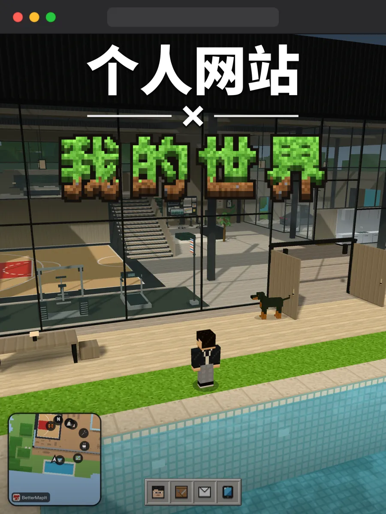
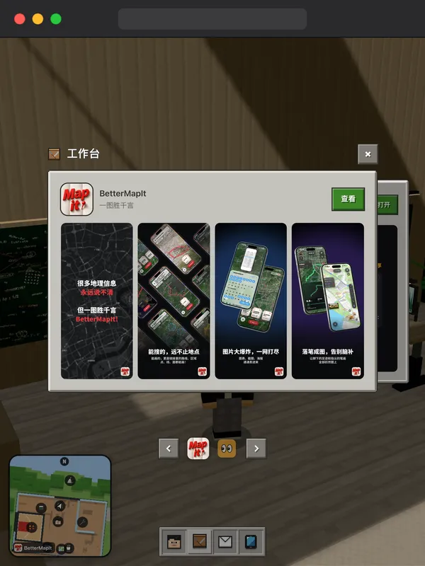
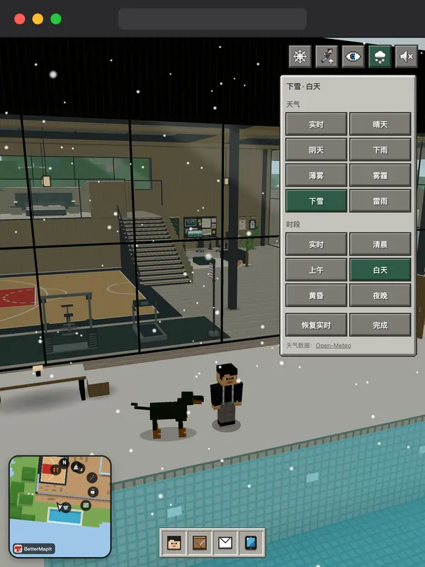
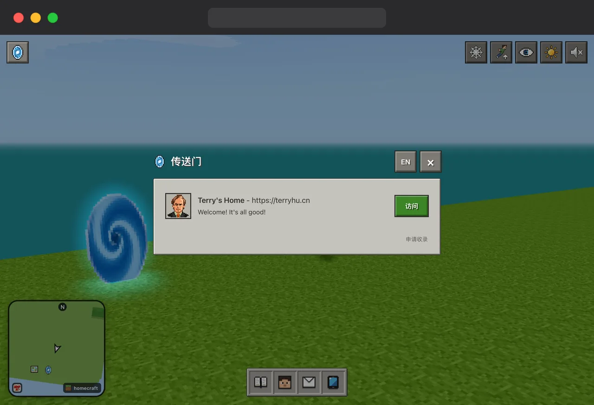

# Homecraft

**中文** · [English](README.en.md)

## 个人网站即我的世界

过去我是个喜欢折腾网站的人，但模板换了又换，总感觉被什么东西困住了。

受我的世界、黑客帝国和元宇宙的启发，借助 AI，我把个人网站从二维网页建成了三维世界。

这个世界包罗万象，可以自由移动，里面建了篮球场，健身房，工作台，甚至还有昼夜交替和天气系统。

对于二维网页也完全可以内嵌进来，例如按 F 查看。而且得益于方块风的性能开销小，手机也能轻松访问。

逛上一圈，像是去朋友家做客了一趟。比起传统的网站，这样的相识或许更让人印象深刻。

一旦接受了这个设定，就再也回不去传统个人网站了…  

 

## 实机截图 [🔗 Terry’s Home](https://terryhu.cn)

| 篮球场                                   | 泳池                                 | 工作台                                 |
| :-----------------------------------: | :--------------------------------: | :---------------------------------: |
|   |  |  |
| **作品展示**                              | **健身房**                            | **天气系统**                            |
|  |  |   |

## 开始使用

项目已内置初始模板、相关提示词与约束，fork 之后即刻 vibe coding “我的世界”。

在项目目录运行 `npm run serve`，会用 Docker 构建并在 `http://127.0.0.1:9998/` 提供服务；没有 Docker 时，用任意会返回 `Cache-Control: no-cache` 的静态服务器指向项目根目录即可。

Terry's Home完整实现见 [examples/terry-home](examples/terry-home)。  

## 传送门 [🔗 申请收录](https://github.com/terryHu7/homecraft/issues/new/choose)

类似传统博客的友链，传送门收录了大家的个人网站，方便互相“串门”。
 
 

## 友情链接 [🔗 LINUX DO](https://linux.do)
